# VIP Notebook Entry — Week 1: Baseline Architecture, Modularization & Performance Benchmarking
**Project:** Connected & Autonomous Vehicle (CAV) Intersection Control  
**Lab:** ACT Driving Simulator VIP Team (Prof. Srinivas Peeta)  
**Sub-Team:** Sub-Team 4 — Speed Optimization & Intelligent Intersection Control  
**Student:** Narainkarthigeyan Singaram Balamurugan  
**Date:** September 29, 2026  

---

## 1. Objectives for the Week
1. Analyze and modularize the baseline Model Predictive Control (MPC) and First-In-First-Out (FIFO) intersection controller.
2. Formulate and implement a standardized quantitative metric evaluation suite:
   - System Clearance Time ($T_{sys}$) and Effective Throughput ($\text{veh/hr}$)
   - Individual Vehicle Wait/Delay Time at stop line ($t_{release} - t_{stop}$)
   - Total Trip Travel Time
   - Control Effort / Energy Proxy ($E = \int a^2 dt$)
   - Passenger Comfort Metrics (Peak Jerk & RMS Jerk)
3. Construct a top-down 2D bird's-eye view animated visualization of the 4-way intersection to verify spatial clearance and vehicle coordination visually.
4. Establish clean Git repository version control and a semester roadmap for subsequent weekly deliverables.

---

## 2. Mathematical Formulation & Control Architecture

### 2.1 Vehicle Kinematic State Model
Each autonomous vehicle $i$ is modeled via discrete longitudinal double-integrator dynamics:

$$
x_k = \begin{bmatrix} p_k \\ v_k \end{bmatrix}, \quad u_k = a_k
$$

$$
p_{k+1} = p_k + v_k \Delta t + \frac{1}{2} a_k \Delta t^2
$$

$$
v_{k+1} = v_k + a_k \Delta t
$$

where:
- $\Delta t = 0.20\text{ s}$ (sampling time)
- $N = 20$ (prediction horizon, representing a $4.0\text{ s}$ lookahead)
- $p = 0.0\text{ m}$ is the designated Stop Line
- $p = 12.0\text{ m}$ denotes the downstream Intersection Exit boundary

### 2.2 Dual-Stage Model Predictive Control (MPC)

#### Problem 1: Approach & Deceleration to Stop Line (STOP)
When a vehicle is in the `APPROACH` state, the MPC minimizes the objective function:

$$
J_{\text{stop}}(a_0, \dots, a_{N-1}) = W_{\text{pos}} \cdot p_N^2 + W_{\text{speed}} \cdot v_N^2 + \sum_{k=0}^{N-1} \left[ W_{\text{acc}} \cdot a_k^2 + W_{\text{cross}} \cdot \max(p_{k+1}, 0)^2 \right]
$$

- $W_{\text{pos}} = 100.0$: Penalizes terminal displacement from the stop line ($p=0$).
- $W_{\text{speed}} = 150.0$: Enforces near-zero terminal speed ($v=0$).
- $W_{\text{acc}} = 0.20$: Smooths control inputs and minimizes energy expenditure.
- $W_{\text{cross}} = 2000.0$: Heavy penalty on prematurely crossing into the intersection conflict zone.

#### Problem 2: Controlled Acceleration Through Intersection (GO)
Once released by the intersection scheduler, the vehicle transitions to `GO` and optimizes:

$$
J_{\text{go}}(a_0, \dots, a_{N-1}) = \sum_{k=0}^{N-1} \left[ W_{\text{speed}} \cdot (v_{k+1} - V_{\text{des}})^2 + W_{\text{acc}} \cdot a_k^2 \right]
$$

where $V_{\text{des}} = 8.0\text{ m/s}$ is the target crossing speed.

### 2.3 FIFO Right-of-Way Logic
Vehicles reaching $|p| \le 0.5\text{ m}$ and $v \le 0.2\text{ m/s}$ enter the `WAIT` state and are queued in chronological order of arrival. The intersection grants exclusive single-vehicle access to the head of the queue until that vehicle reaches $p \ge 12.0\text{ m}$.

---

## 3. Quantitative Baseline Experimental Results

The baseline scenario comprises four vehicles simultaneously approaching an un-signalized 4-way stop:
- Vehicle 1: West ($p_0 = -24.0\text{ m}$, $v_0 = 7.0\text{ m/s}$)
- Vehicle 2: East ($p_0 = -30.0\text{ m}$, $v_0 = 7.5\text{ m/s}$)
- Vehicle 3: South ($p_0 = -36.0\text{ m}$, $v_0 = 8.0\text{ m/s}$)
- Vehicle 4: North ($p_0 = -42.0\text{ m}$, $v_0 = 8.0\text{ m/s}$)

### System-Level Performance Summary
| Metric | Baseline Value | Units |
| :--- | :--- | :--- |
| **Total Vehicles Processed** | 4 | vehicles |
| **System Clearance Time ($T_{sys}$)** | 13.20 | s |
| **Effective Throughput** | 1090.9 | veh / hr |
| **Average Stop Delay** | 2.25 | s |
| **Maximum Stop Delay** | 4.60 | s (Vehicle 4) |
| **Average Trip Travel Time** | 12.10 | s |
| **Total Control Effort ($\sum a^2 \Delta t$)** | 1310.44 | $\text{m}^2/\text{s}^3$ |
| **Mean RMS Jerk** | 35.16 | $\text{m}/\text{s}^3$ |

### Individual Vehicle Breakdown
| ID | Approach | Priority | Stop Time ($s$) | Release Time ($s$) | Exit Time ($s$) | Wait Delay ($s$) | Control Energy |
| :---: | :---: | :---: | :---: | :---: | :---: | :---: | :---: |
| **1** | West | 1 | 6.2 | 6.2 | 7.8 | **0.0** | 312.7 |
| **2** | East | 2 | 6.6 | 8.0 | 9.6 | **1.4** | 319.9 |
| **3** | South | 3 | 6.8 | 9.8 | 11.4 | **3.0** | 330.6 |
| **4** | North | 4 | 7.0 | 11.6 | 13.2 | **4.6** | 347.2 |

---

## 4. Breakthrough Deliverable: Conflict-Matrix Concurrent Scheduler

To directly address the strict FIFO bottleneck, I designed and implemented `ConcurrentScheduler` (`src/controllers/concurrent_scheduler.py`). Instead of a single active car lock, it evaluates geometric path conflict pairs before dispatch:

- Opposing parallel streams: $\text{West} \leftrightarrow \text{East}$ and $\text{South} \leftrightarrow \text{North}$ do not physically intersect inside their dedicated travel lanes.
- Whenever a vehicle at the head of the queue is dispatched, the scheduler immediately scans pending queued vehicles and grants concurrent green right-of-way to any vehicle that shares no conflict with currently crossing vehicles.

### Comparative Benchmark: Baseline FIFO vs. Concurrent Conflict Matrix
| Performance Metric | Baseline FIFO | Concurrent Conflict Matrix | Quantitative Delta |
| :--- | :---: | :---: | :---: |
| **System Clearance Time ($T_{sys}$)** | 13.20 s | **10.00 s** | **-24.2% (Faster)** |
| **Average Stop Delay** | 2.25 s | **0.75 s** | **-66.7% (Reduced)** |
| **Maximum Stop Delay** | 4.60 s | **1.60 s** | **-65.2% (Reduced)** |
| **Effective Throughput** | 1090.9 veh/h | **1440.0 veh/h** | **+32.0% (Higher)** |
| **Total Control Energy** | 1310.44 | 1310.44 | Parity |

```mermaid
xychart-beta
    title "Delay & Clearance Time Comparison (s)"
    x-axis ["Clearance Time", "Average Delay", "Max Delay"]
    y-axis "Seconds" 0 --> 15
    bar [13.20, 2.25, 4.60]
    bar [10.00, 0.75, 1.60]
```

---

## 5. Artifacts & Code Deliverables Generated
- `src/models/vehicle.py` — Kinematic state model & trajectory container.
- `src/controllers/mpc_controller.py` — Modular dual-stage MPC optimizer.
- `src/controllers/fifo_scheduler.py` — Strict FIFO baseline controller.
- `src/controllers/concurrent_scheduler.py` — Conflict-matrix concurrent crossing coordinator.
- `src/metrics/evaluator.py` — Quantitative metric evaluation suite.
- `src/visualization/animator_2d.py` — 2D bird's-eye view animated GIF renderer.
- `results/intersection_animation.gif` — 2D animated simulation demo.
- `results/comparison_fifo_vs_concurrent.png` — Comparative benchmark figure showing throughput and delay improvements.
- `results/mpc_dashboard.png` — 3-panel synchronized trajectory dashboard.
- `results/metrics_summary.csv` — Quantitative CSV export.

---

## 6. Action Items for Week 2
- [ ] Implement multi-vehicle queueing per lane with car-following headway constraints:  
  $$p_{\text{lead}} - p_{\text{follow}} \ge d_{\text{safe}} + v \cdot \tau$$
- [ ] Integrate bounded optimization solver (`SLSQP` / `OSQP`) to enforce hard acceleration bounds ($-4.0 \le a \le 2.5\text{ m/s}^2$) and minimize jerk.
- [ ] Present the baseline vs. concurrent comparative study during the sub-team standup meeting.

